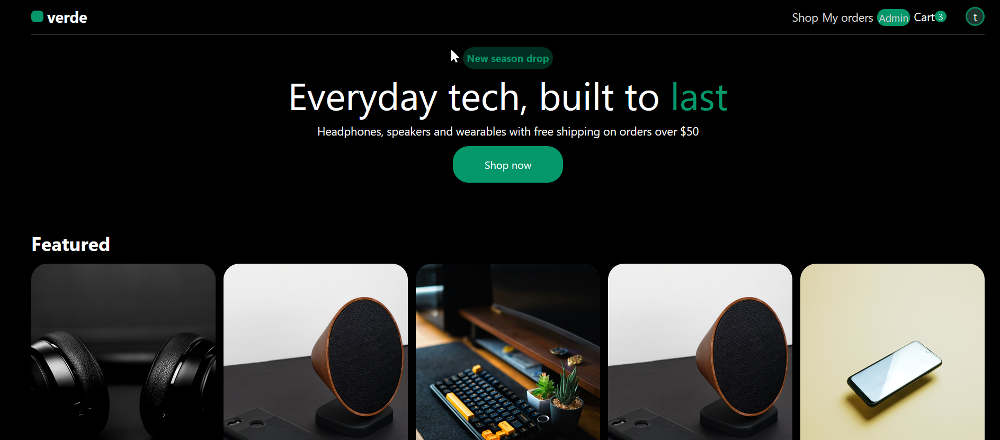
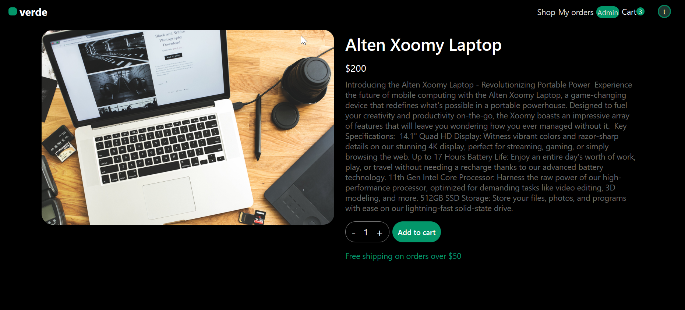
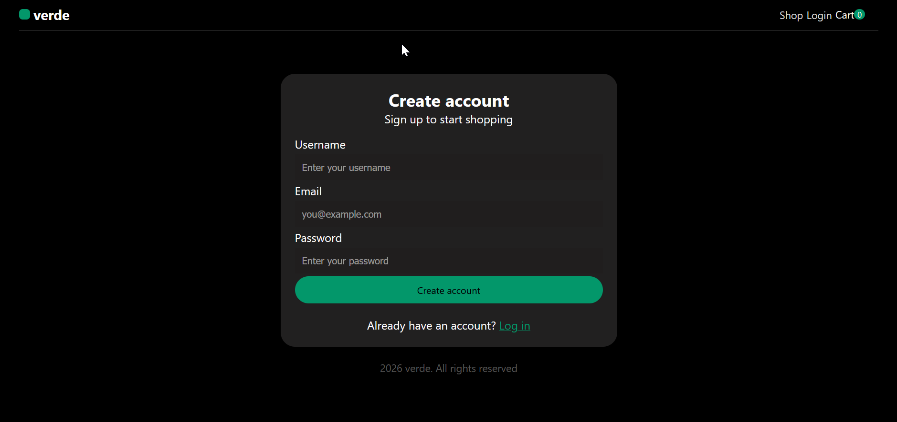
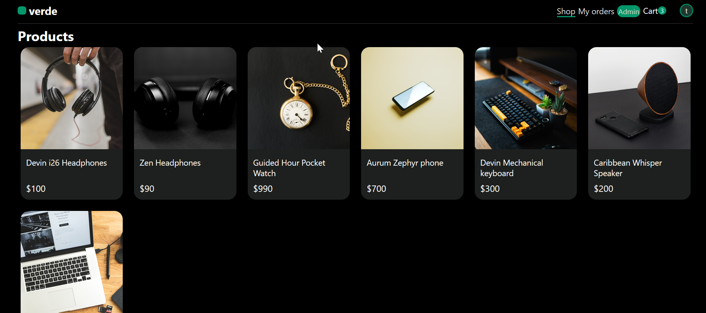
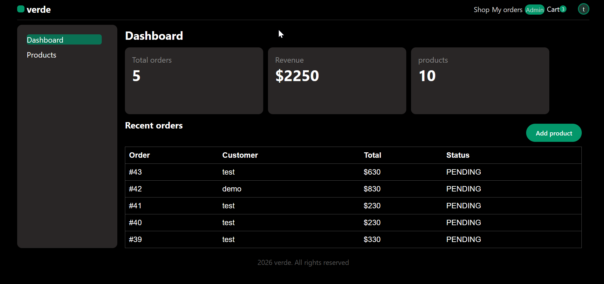
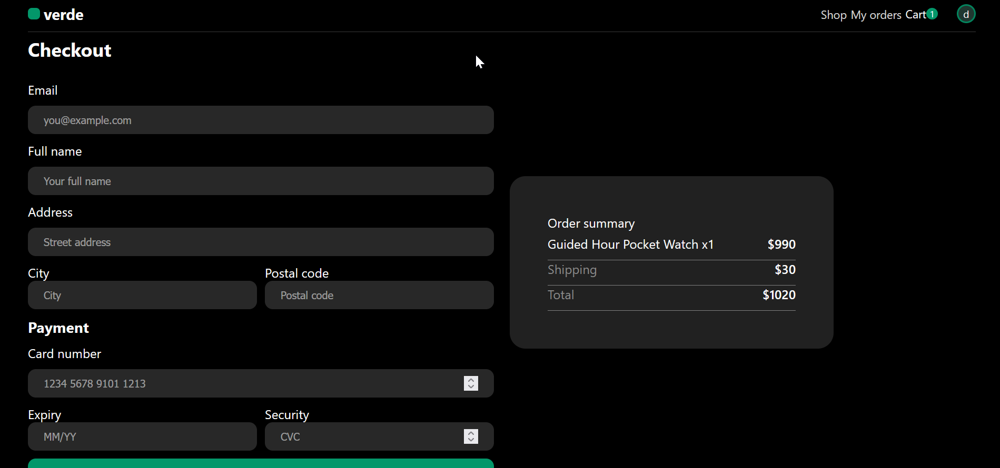

# verde

A small online shop for everyday tech: headphones, speakers,office equipment, watches and earbuds.


## Tech stack

- **Frontend:** React
- **Backend:** Node.js with Express
- **Styling:** plain CSS (black background, #03976A accent)

## Features

- Browse products and view product details
- Add items to a cart and review them
- Sign up, log in and see your past orders
- Checkout form with shipping and payment fields
- Simple admin pages for products and orders

Payments are not connected to a payment provider yet. Card fields are placeholders until one is added.

## Getting started

### Requirements

- Node.js 18 or newer
- npm

## Development 

```bash
# Install dependencies (adjust paths if using a monorepo setup)
npm install

# Run development server
npm run dev

```

## Status

verde is currently in development

## Screenshots

### Home




### Product Details 


### Verde Auth


### Verde Products


### Verde Admin


### Verde Checkout
